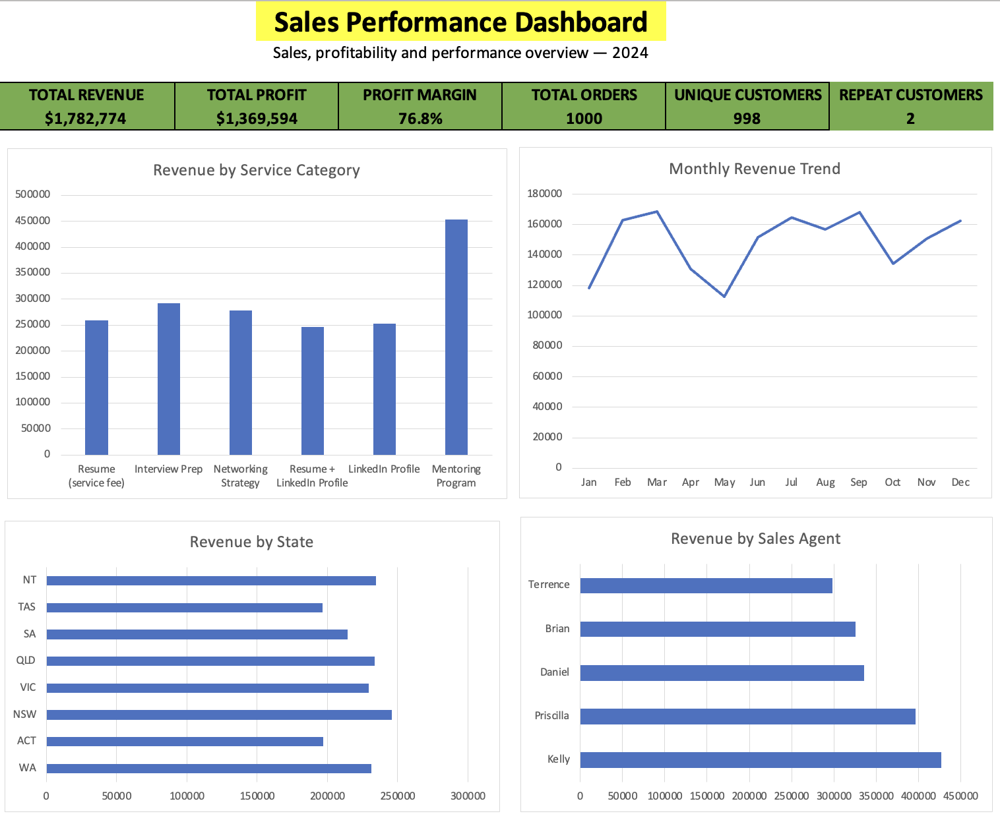

# Sales Analytics Dashboard — Excel

## Project Overview

This project analyses sales performance using Microsoft Excel to identify revenue trends, profitability patterns, customer behaviour and service category performance. The goal was to turn raw sales data into meaningful business insights that can support decision-making.

## Dashboard Preview

## Tools Used

- **Microsoft Excel** — data analysis and dashboard development
- **Excel formulas and data validation** — data quality checks
- **Pivot tables and charts** — summarising and visualising performance metrics

## Project Objectives

- Analyse total revenue, profit and profit margin.
- Understand sales performance across service categories.
- Examine customer purchasing patterns.
- Validate data quality before conducting analysis.
- Present key findings through an interactive dashboard and recommendations.

## Data Preparation

The project involved reviewing the raw sales and customer data, checking data consistency and preparing an analysis-ready dataset.

Data quality checks included:
- Validating order dates and quantity values.
- Reviewing customer identifiers and repeat purchases.
- Checking records for data quality issues.
- Preparing structured data for analysis and dashboard reporting.

All 1,000 orders passed the project's defined data quality checks.

## Key Findings

- **Total revenue:** $1,782,774
- **Total profit:** $1,369,594.05
- **Average profit margin:** 76.7%
- **Total orders:** 1,000
- **Unique customers:** 998
- **Repeat-customer rate:** Approximately 0.20%
- **Top-performing service:** Mentoring Program, generating $453,321 in revenue across 265 orders.

## Dashboard Features

The Excel dashboard presents key performance indicators and sales insights to help users understand overall business performance.

The analysis covers:
- Revenue and profit performance.
- Profit margin.
- Service category comparisons.
- Customer purchasing patterns.
- Data quality validation.

## Recommendations

- Investigate opportunities to encourage repeat purchases and improve customer retention.
- Review the Mentoring Program's performance to understand the factors contributing to its high revenue.
- Monitor revenue, profit and margin regularly to identify changes in business performance.
- Continue performing data quality checks before updating reports.

## Learning Outcomes

This project strengthened my practical skills in Excel-based data cleaning, analysis, validation and dashboard development. It also demonstrated how structured reporting can turn raw business data into actionable insights.
